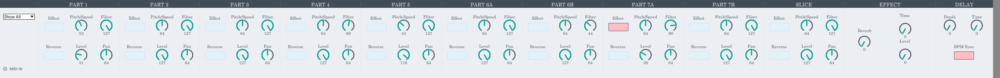

# 🌉 Electribe ES-1 Bridge

Bidirectional Max for Live controller for the Korg Electribe ES-1.

This repository provides a **bidirectional Max for Live controller** for the **Korg Electribe ES-1**, bringing its main part parameters, global effects and delay controls directly into **Ableton Live 12**.

Changes made on the ES-1 are reflected in Max for Live, while changes made in the device are sent back to the hardware through MIDI/NRPN communication.

> Independent community project. Not affiliated with or endorsed by Korg, Ableton, or Cycling '74.

## 🎯 Goal

Turn the Korg Electribe ES-1 into a tightly integrated Ableton Live instrument while preserving the immediacy of hands-on hardware control.

## 🧩 Included in this Repository

- `Electribe_ES-1_Bridge.amxd`: frozen Max for Live device
- `DOCS/SETUP.md`: installation and routing guide
- `DOCS/TROUBLESHOOTING.md`: common issues and fixes
- `DOCS/MIDI_NOTES.md`: MIDI / NRPN implementation notes
- `DOCS/FREEZE_AND_RELEASE.md`: release workflow
- `CREDITS.md`: project provenance and upstream attribution
- `CHANGELOG.md`: version history
- `CONTRIBUTING.md`: contribution guidelines
- `LICENSE.md`: license information

## ⚙️ Requirements

- Korg Electribe ES-1
- Ableton Live with Max for Live
- MIDI interface with MIDI IN and MIDI OUT
- Two standard 5-pin MIDI cables for full bidirectional operation

### Tested with

- Ableton Live 12
- Max 8.6.5
- Windows x64
- Korg Electribe ES-1 mk1

Other configurations may work but have not yet been formally tested.

## 🛠 Features

- Bidirectional ES-1 ↔ Max for Live control
- Support for Parts 1–5, 6A/6B, 7A/7B and Slice
- Pitch / Speed, Filter, Level and Pan controls
- Per-part Effect On / Off
- Per-part Reverse On / Off
- Global Effect Type control with all 11 ES-1 effects
- Effect Edit 1 / Edit 2
- Global Delay Depth / Time
- BPM Sync
- Part View selector for focused editing
- Custom presentation-mode interface
- Hardware feedback from incoming MIDI/NRPN data

## 📦 Getting Started

1. Download `Electribe_ES-1_Bridge.amxd`.
2. Copy it into your Ableton User Library or another folder indexed by Ableton Live.
3. Connect ES-1 MIDI OUT → MIDI interface IN.
4. Connect MIDI interface OUT → ES-1 MIDI IN.
5. Load the device on the MIDI track used for the ES-1.
6. Set Ableton Live to receive MIDI from the ES-1.

The ES-1 factory MIDI channel is **11**.

For the complete setup guide, see:  
📄 [`DOCS/SETUP.md`](DOCS/SETUP.md)

## 🎛 Effect Types

| Value | Effect |
|---:|---|
| 0 | Reverb |
| 1 | Flanger / Chorus |
| 2 | Phaser |
| 3 | Ring Modulator |
| 4 | Pitch Shifter |
| 5 | Compressor |
| 6 | Distortion |
| 7 | Decimator |
| 8 | Isolator |
| 9 | Resonant Filter |
| 10 | Wah |

The ES-1 uses one global effect type per pattern. Each part can independently enable or disable its Effect switch.

## ⏱ Delay

Delay is global to the pattern and provides:

- Depth
- Time
- BPM Sync

BPM Sync links Delay Time to the current pattern tempo.

## 📚 Documentation

- [Setup](DOCS/SETUP.md)
- [Troubleshooting](DOCS/TROUBLESHOOTING.md)
- [MIDI implementation notes](DOCS/MIDI_NOTES.md)
- [Freeze & release workflow](DOCS/FREEZE_AND_RELEASE.md)
- [Credits & provenance](CREDITS.md)
- [Changelog](CHANGELOG.md)
- [Contributing](CONTRIBUTING.md)
- [License](LICENSE.md)

## 🧬 Credits & Provenance

Electribe ES-1 Bridge is based on and substantially reworks **Electribe ES1 Full Kontrol v1.25** by **okan**, originally published on maxforlive.com in 2010 under an **AttributionNonCommercial** license.

Original device:  
https://maxforlive.com/library/device/335/electribe-es1-full-kontrol

Electribe ES-1 Bridge adds a redesigned interface, direct bidirectional MIDI/NRPN handling, updated routing logic, expanded hardware feedback, documentation, troubleshooting and a modern release workflow.

See [`CREDITS.md`](CREDITS.md) for full provenance.

## 📜 License

Electribe ES-1 Bridge is distributed for **non-commercial use** under the **Creative Commons Attribution-NonCommercial 4.0 International (CC BY-NC 4.0)** license.

Portions derived from **Electribe ES1 Full Kontrol v1.25** remain subject to the original AttributionNonCommercial terms under which that device was published.

See [`LICENSE.md`](LICENSE.md).

## ✨ Versioning

Current release: **v1.0.0**

- `v1.0.1` — bug fix
- `v1.1.0` — backwards-compatible feature update
- `v2.0.0` — major revision or breaking change

The distributed device remains named:

`Electribe_ES-1_Bridge.amxd`

Versions are tracked through Git tags and GitHub Releases rather than appended to the filename.

## ✍🏻 Author

Project redevelopment, interface redesign and documentation by [runwithscissor](https://github.com/runwithscissor).

📩 Feedback, bug reports and compatibility reports are welcome through GitHub Issues.

📷 Check my [Instagram](https://www.instagram.com/runwithscissor)

---

Enjoy bridging the Electribe ES-1 with Ableton Live! 🎛️🌉
